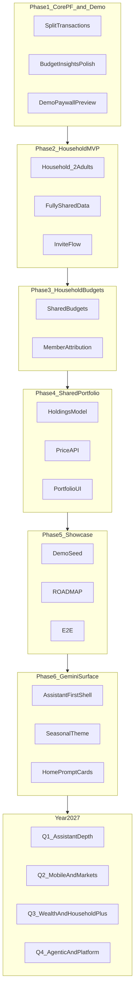

# FiscalNorth Product Roadmap

This document captures the planned direction for FiscalNorth as a **portfolio showcase project**: polish core personal finance features, then add household collaboration and a shared investment portfolio.

## Vision

| Decision | Choice |
|----------|--------|
| **Goal** | Portfolio / showcase project |
| **Top priority** | Core personal finance gaps (split transactions, insights, budgets) |
| **Must-have features** | Household budgets + shared portfolio |
| **Household size** | MVP: 2 adults (owner + member) |
| **Portfolio data** | Live price API with cached quotes |
| **Privacy model** | Fully shared — both members see all household data |
| **Premium demo** | Keep paywall visible; unlock features via "Try in demo" (no Stripe required) |
| **UI direction** | Gemini-inspired assistant-first shell, with a seasonal winter theme around the holidays |

## Current state (Nov 2026)

**Implemented**

- Split transactions (API + UI, budget/insights aware)
- Demo paywall preview (`DEMO_PREMIUM_PREVIEW`, "Try in demo")
- Household MVP: 2 adults, fully shared data, invite + join flow
- Shared budgets with per-member attribution and remaining column
- Shared portfolio with Alpha Vantage + cached fallback, daily price cron
- Dashboard: net worth, household budget KPI, category drill-down
- Demo seed: Alex + Jamie, split transaction, portfolio holdings
- Cypress E2E for household, portfolio, splits, paywall unlock
- Gemini-inspired app shell (collapsible sidebar, home greeting, prompt cards, composer)
- Holiday season theme (15 Nov–6 Jan, user-toggleable)

**Demo accounts**

| User | Email | Password |
|------|-------|----------|
| Alex (owner) | `alex@fiscalnorth.local` | `demo1234` |
| Jamie (member) | `jamie@fiscalnorth.local` | `demo1234` |

---

## Roadmap overview

---

## Phase status

| Phase | Status | Notes |
|-------|--------|-------|
| 1 — Core PF + demo paywall | **Done** | PR #11 |
| 2 — Household foundation | **Done** | PR #12 |
| 3 — Household budgets | **Done** | Member breakdown, household cron alerts |
| 4 — Shared portfolio | **Done** | Allocation chart, net-worth KPI, price cron |
| 5 — Showcase polish | **Done** | Demo seed, E2E, docs |
| 6 — Gemini-inspired surface | **In progress** | Assistant-first shell + holiday season theme |
| 2027 Q1 — Assistant depth | Planned | Chat history, household insights, invite email |
| 2027 Q2 — Mobile & markets | Planned | PWA, AT/CH copy, multi-currency display |
| 2027 Q3 — Wealth & Household Plus | Planned | Live depot sync, 3rd-member viewer, tax pack |
| 2027 Q4 — Agentic platform | Planned | Confirmed workflows, live notifications, B2B2C |

---

## Sequenced backlog

| # | Item | Phase | Status |
|---|------|-------|--------|
| 1 | Split transactions | 1 | Done |
| 2 | Budget & insights polish | 1 | Done |
| 3 | Demo paywall preview | 1 | Done |
| 4 | Household foundation (2 adults, fully shared) | 2 | Done |
| 5 | Household budgets | 3 | Done |
| 6 | Shared portfolio + price API | 4 | Done |
| 7 | Demo seed + E2E tests | 5 | Done |
| 8 | README / docs sync | 5 | Done |
| 9 | Gemini-inspired shell + home composer | 6 | In progress |
| 10 | Holiday season theme (Yule) | 6 | In progress |

---

## 2027 plan

Phases 1–5 shipped a working household PF showcase. 2027 is about making the assistant the product surface, then widening household and wealth features without abandoning the Nordic, demo-friendly positioning.

### Priority legend

| Priority | Meaning |
|----------|---------|
| **P0** | Next up — needed for the Gemini-style surface to feel complete |
| **P1** | High leverage for the household story |
| **P2** | Showcase differentiators |
| **P3** | Later / optional unless a demo needs it |

### Q1 2027 — Assistant depth & household polish

The new home is a Gemini-style composer. Q1 makes that composer remember context and act for both partners.

| Priority | Item | Why |
|----------|------|-----|
| P0 | Persisted assistant conversations + "recent chats" in the sidebar | The shell already has New chat; history is the missing Gemini piece |
| P0 | Prompt-card analytics that stay on-device / i18n-safe | Cards currently jump to `/assistant`; keep copy and queries translated |
| P1 | Email (or demo-token) household invites instead of UI-only tokens | Unblocks a realistic couple onboarding demo |
| P1 | Split-expense UX on transactions (who paid, who owes) | Budgets already attribute spend; the booking flow should match |
| P1 | AI household insights ("yours / mine / ours" recap) | Uses existing shared data + Gemini actions |
| P2 | Optional private accounts inside a household | Most-requested privacy gap; keep default fully shared |
| P2 | WebSocket budget alerts in the shell | Config exists; no client subscription yet |

### Q2 2027 — Mobile surface & DACH expansion

| Priority | Item | Why |
|----------|------|-----|
| P0 | Installable PWA (offline shell, add-to-home-screen) | Fastest path to a "mobile app" story for the portfolio |
| P1 | Responsive Gemini layout QA on 390px / 768px | Sidebar already collapses; forms and portfolio chart need a pass |
| P1 | Multi-currency display (EUR default, CHF/USD holdings) | Portfolio already has tickers like VWCE.DE |
| P2 | AT/CH copy, IBAN examples, and holiday calendars | Aligns with the business-plan DACH expansion |
| P2 | Seasonal themes as a platform (Yule, Easter, summer) | Christmas work should become a reusable `data-season` system |
| P3 | Native iOS/Android | Keep out of the web MVP unless the PWA is clearly not enough |

### Q3 2027 — Wealth, tax year, Household Plus

| Priority | Item | Why |
|----------|------|-----|
| P1 | Live depot / brokerage sync (or a richer manual lot model) | Shared portfolio is holdings + cached quotes today |
| P1 | Year-end pack: exports, gift-budget recap, savings-rate story | Natural follow-on from the holiday prompt cards |
| P2 | Household Plus: viewer / child role, 3rd adult | MVP is 2 adults; Plus is the business-plan upsell |
| P2 | Goal contributions from shared vs personal pots | Connects goals, budgets, and household |
| P3 | Tax reporting (DE Anlage, CH / AT later) | High effort; ship a "what to gather" assistant flow first |

### Q4 2027 — Agentic workflows & platform

| Priority | Item | Why |
|----------|------|-----|
| P1 | Multi-step confirmed actions (create budget → assign category → notify partner) | Assistant already proposes one-shot actions |
| P1 | STOMP notifications for bank-sync and budget overruns | Platform hooks are in place |
| P2 | RabbitMQ/Kafka bridge for AI jobs and audit | Compose already runs the brokers |
| P2 | B2B2C / white-label exploration | Business-plan Q4; treat as a spike, not a product line |
| P3 | Stripe live checkout | Keep demo paywall as the default showcase path |

### Rough 2027 outline

| Quarter | Product theme | Showcase demo to tell |
|---------|---------------|----------------------|
| **Q1** | The assistant remembers and acts for the household | Alex opens a saved "December spending" chat; Jamie confirms a gift budget |
| **Q2** | Same product on a phone, usable in CH/AT | Install PWA, switch locale, see CHF holdings next to EUR |
| **Q3** | Shared wealth + a year-end story | Portfolio lots update, year recap PDF, optional third viewer |
| **Q4** | Agentic finance, still confirm-before-write | "Set up a holiday sinking fund" runs several confirmed actions; live alerts |

---

## Out of scope (for now)

- Stripe live checkout / production billing
- Private accounts within a household *(moves to P2 in Q1 2027)*
- Viewer/child roles, households with 3+ members *(moves to Household Plus, Q3 2027)*
- Email delivery for household invites (token shown in UI for demo) *(Q1 2027)*
- Tax reporting, multi-currency conversion *(display in Q2; reporting later)*
- Mobile native apps *(PWA first in Q2)*
- Production XS2A bank connections

---

## Related documentation

- [README.md](README.md) — project overview and setup
- [docs/AUTH.md](docs/AUTH.md) — authentication and demo login
- [docs/BILLING.md](docs/BILLING.md) — Stripe premium setup
- [docs/DEPLOY.md](docs/DEPLOY.md) — production deployment
- [docs/business/BUSINESS_PLAN.md](docs/business/BUSINESS_PLAN.md) — commercial milestones (seed, ARR)
